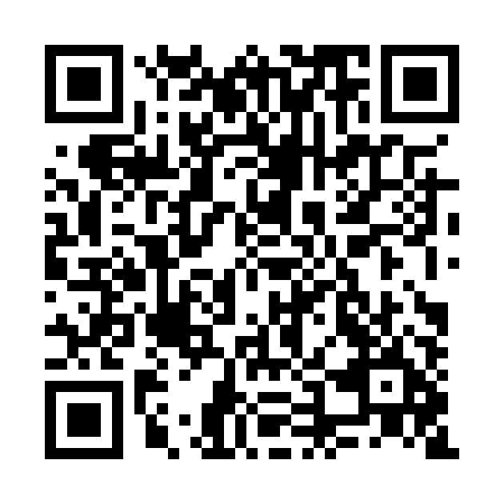

# THE CORE - README.md

**Universitat Oberta de Catalunya**
06.540 – Realitat virtual – Aula 1 - Curs 2026-27/1
PAC3. Tutorial d'A-FRAME 360º

**Autor:** Jose López Sender

---

## 1.- Introducció

THE CORE és una experiència immersiva en 360º d'un reactor futurista. Aquesta experiència combina la visualització d'una imatge panoràmica 360º estàtica amb la visualització d'un vídeo animat en 360º.

La idea principal era crear una sala futurista amb un reactor al centre, envoltat d'estructures, amb elements lluminosos i amb diferents animacions.

A partir d'aquest entorn he generat una imatge panoràmica estàtica i un vídeo de 360º, que després he integrat en una pàgina web amb A-frame.

## 2.- Disseny i modelatge de l'escenari

Vaig començar modelant els diferents elements amb SketchUp, ja que per modelar estructures senzilles em resulta més fàcil i ràpid treballar amb aquest programa. Al centre de l'escenari hi vaig situar el reactor i al seu voltant hi vaig incorporar les estructures metàl·liques, els anells al terra i al sostre i diferents barres de llum flotant per donar sensació de perspectiva.

Un cop acabat el modelatge de tots els elements vaig continuar el procés amb Blender per poder aplicar materials, les llums a l'escena i les animacions. 

Per ambientar l'escena vaig combinar estructures fosques amb materials metàl·lics i amb elements emissius de colors intensos, per aconseguir una sala amb una atmosfera futurista.

A diferència d'un render convencional de vista frontal, una imatge o un vídeo panoràmic tenim una vista 360º de tot l'escenari, per aquest motiu vaig distribuir diferents elements per tot l'espai, no solament davant de la càmera.

## 3.- Animació de l'escenari

Per poder crear el vídeo panoràmic vaig animar diferents elements de la sala deixant la càmera fixa.

Les diferents animacions incorporades són:

- Rotació de dos dels elements i canvis d'intensitat del reactor central.
- Moviment en vertical i horitzontal de les barres lluminoses i variacions d'intensitat d'il·luminació.
- Animació en horitzontal i canvis de tonalitat i d'intensitat de la il·luminació de les quatre estructures del reactor.
- Efectes d'il·luminació als anells del terra i del sostre.

## 4.- Renderització panoràmica

Per generar la imatge i el vídeo vaig continuar treballant amb Blender amb el motor de renderitzat Cycles.

Vaig configurar una càmera panoràmica amb projecció equirectangular, d'aquesta forma podem representar l'entorn amb una proporció de 2:1.

Posteriorment aquesta imatge la projectem sobre una esfera virtual mitjançant A-Frame, d'aquesta forma l'espectador pot mirar en qualsevol direcció.

Per la versió estàtica vaig generar una imatge JPG i per la versió animada una seqüència de 192 fotogrames a 24 fps, que equivalen a 8 segons d'animació.

### Característiques tècniques

| Recurs | Característiques |
|---|---|
| Imatge panoràmica | JPG · 2048 × 1024 píxels |
| Vídeo panoràmic | MP4 · 1920 × 960 píxels |
| Projecció | Equirectangular |
| Motor de renderització | Blender Cycles |
| Animació | 192 fotogrames |
| Velocitat | 24 fps |
| Durada prevista | 8 segons |
| Còdec de vídeo previst | H.264 |

## 5.- Desenvolupament de la pàgina web

Una vegada acabats els recursos gràfics vaig crear una pàgina web per poder visualitzar-los. 

He fet servir HTML5 per estructurar la pàgina, CSS3 per definir l'aspecte visual i JavaScript per poder controlar la interacció entre els diferents elements. 

Per a la visualització dels continguts en 360º vaig treballar amb A-Frame 1.7.1.

Aquesta pàgina web incorpora dos elements principals:

- **`<a-sky>`:** que ens permet mostrar la imatge panoràmica estàtica.
- **`<a-videosphere>`:** que ens permet reproduir el vídeo panoràmic dins d'una esfera virtual.

A la part superior de la pàgina vaig afegir dos botons perquè l'usuari pugui alternar entre les dues visualitzacions.

Quan seleccionem PANORAMA 360º es mostra la imatge estàtica i es pausa el vídeo. Quan seleccionem VÍDEO 360º, s'inicia o es reprèn la reproducció del vídeo i s'oculta la imatge. 

Aquesta interacció està programada amb JavaScript fent servir esdeveniments de clic i modificant la visualització dels diferents elements A-Frame.

També hi ha incorporada una gestió bàsica d'errors per informar l'usuari si el navegador no pot iniciar la reproducció.

### Disseny de la interfície

Per als controls he mantingut la mateixa estètica amb els botons de color cian i efectes lluminosos, seguint el mateix llenguatge visual que a l'escenari.

Aquests botons canvien d'aparença segons quin tenim seleccionat, d'aquesta forma l'usuari pot identificar en quina escena es troba.

També vaig adaptar la visualització d'aquests controls per a pantalles petites.

## 6.- Estructura del projecte

El projecte segueix la següent estructura:

```text
PAC3_Lopez_Jose/
├── index.html
├── README.md
├── LICENSE.md
├── blender/
│   ├── THE_CORE_animacio.blend
│   └── THE_CORE_escenari.blend
├── codiQR/
│   ├── THE_CORE_QR.png
├── css/
│   └── style.css
├── js/
│   └── script.js
└── recursos/
    ├── imatges/
    │   └── THE_CORE_360.jpg
    └── videos/
        └── THE_CORE_360.mp4
```

## 7.- Execució i publicació

Pel desenvolupament he fet servir Visual Studio Code amb l'extensió Live Server per executar la pàgina des del servidor local.

Per poder executar THE CORE en local hem de:

1. Descarregar o clonar el repositori.
2. Obrir la carpeta del projecte amb Visual Studio Code.
3. Iniciar Live Server des del fitxer `index.html`.
4. Obrir la pàgina al navegador.
5. Utilitzar els botons per alternar entre les dues experiències de 360º.

### Publicació amb GitHub Pages

Per facilitar l'accés al projecte, aquest s'ha publicat mitjançant GitHub Pages, d'aquesta forma podem allotjar els fitxers de la pàgina web en un repositori GitHub i accedir-hi mitjançant una adreça HTTPS.

## 8.- Accés a THE CORE mitjançant enllaç i codi QR

Per facilitar la visualització del projecte des de diferents dispositius he incorporat un enllaç directe a la pàgina publicada i un codi QR.

Aquest codi QR ens permet obrir l'experiència des d'un telèfon o una tauleta simplement escanejant-lo amb la càmera del dispositiu.

**Enllaç a l'experiència:** https://jlsender.github.io/PAC3_Lopez_Jose/

**Codi QR:**



## 9. Eines i tecnologies utilitzades

| Eina | Utilització |
|---|---|
| SketchUp | Disseny i modelatge inicial de la sala |
| Blender | Modelatge, materials, il·luminació i animacions |
| Cycles | Renderització dels panorames |
| HTML5 | Estructura de la pàgina web |
| CSS3 | Disseny visual de la interfície |
| JavaScript | Programació dels controls i de la reproducció |
| A-Frame 1.7.1 | Visualització immersiva de la imatge i del vídeo 360º |
| Visual Studio Code | Edició del codi i proves en local |
| GitHub | Allotjament i organització dels fitxers |
| GitHub Pages | Publicació de l'experiència web |

## 10. Conclusions

Amb aquesta pràctica he pogut combinar el modelatge tridimensional, l'animació i la programació web en un mateix projecte.

En la meva trajectòria professional ja havia generat imatges de 360º per visualitzar espais arquitectònics i projectes d'interiorisme, però fins ara havia utilitzat programes específics com Pano2VR. Amb aquesta pràctica he pogut experimentar amb una alternativa diferent, integrant directament els panorames en una pàgina web mitjançant A-Frame.

A diferència d'una imatge convencional, per la generació d'imatges o vídeos 360º hem de tenir en compte tot el que envolta a l'espectador i com afecta la seva visualització.

Pel que fa a la programació, m'ha servit per continuar treballant amb A-Frame i entendre com integrar recursos panoràmics dins d'una pàgina web.

El resultat d'aquest treball és una experiència amb una integració senzilla, però que reuneix diferents processos de treball: disseny, modelatge, animació, renderització i desenvolupament web.

## 11. Autoria i referències

Tant el disseny de l'escenari com el modelatge 3D, els materials, les animacions i els diferents recursos han estat creats per aquesta PAC.

El desenvolupament web utilitza A-Frame, una biblioteca de codi obert, juntament amb HTML, CSS i JavaScript.

Podeu consultar les condicions d'ús i de distribució al fitxer `LICENSE.md`.

### Documentació tècnica

- [A-Frame — Documentació oficial](https://aframe.io/docs/1.7.0/introduction/)
- [A-Frame — Sky](https://aframe.io/docs/1.7.0/primitives/a-sky.html)
- [A-Frame — Videosphere](https://aframe.io/docs/1.7.0/primitives/a-videosphere.html)
- [Blender — Manual oficial](https://docs.blender.org/manual/en/latest/)
- [MDN Web Docs — JavaScript](https://developer.mozilla.org/en-US/docs/Web/JavaScript)
- [GitHub Pages — Documentació oficial](https://docs.github.com/en/pages)

---

**PAC 3. Tutorial d'A-FRAME 360º**  
06.540 – Realitat virtual – Aula 1 - Curs 2026-27/1
Jose López Sender  
Grau en Multimèdia · Universitat Oberta de Catalunya

